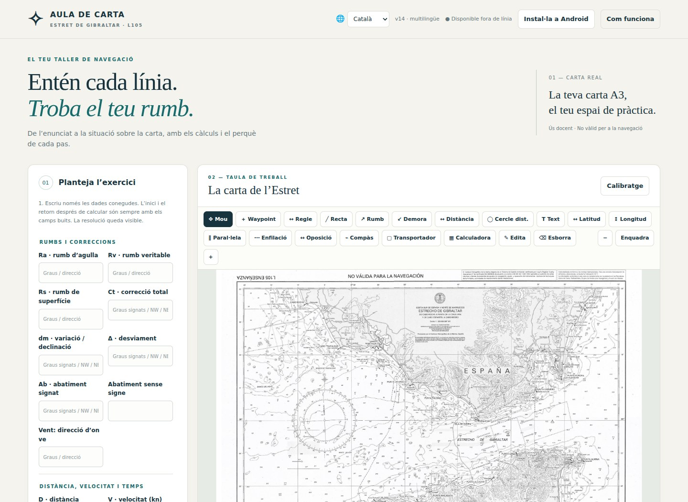
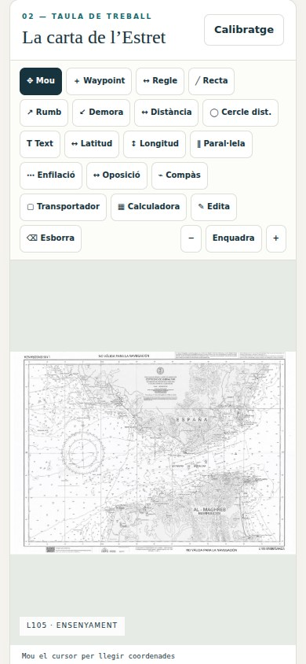

# Aula de carta · Estret

Resol exercicis de carta nàutica pas a pas sobre la carta A3 de l’Estret de Gibraltar.

**[Obre el PWA / Open app](https://guirigall.github.io/ExercicisCartaNautica/)** · [Guia completa](docs/guia-completa.md) · [Incidències](https://github.com/Guirigall/ExercicisCartaNautica/issues)

[Català](#ca) · [Español](#es) · [English](#en) · [Français](#fr)



<details>
<summary>Vista en mòbil / Mobile view</summary>



</details>

<a id="ca"></a>

## Català

Resol exercicis de carta nàutica pas a pas sobre la carta A3 de l’Estret de Gibraltar.

### Què hi trobaràs

- Entrada de variables conegudes i selecció de la incògnita.
- Fórmules, substitució de valors i passos de resolució.
- Transportador giratori, corda, regle, compàs, rectes i arcs.
- Català, espanyol, anglès i francès; sessions en JSON.

### Comença

Omple només els valors coneguts, prem «Tria què vols calcular» i selecciona la incògnita. Després d’un càlcul correcte, els camps es buiden i la resolució queda visible.

### Instal·lació

Obre l’aplicació amb HTTPS. A Android, fes servir Chrome → ⋮ → **Instal·la l’aplicació** o **Afegeix a la pantalla d’inici**. A iPhone: Safari → Compartir → **Afegeix a la pantalla d’inici**. Espera la confirmació de preparació sense connexió abans d’utilitzar el mode avió. No cal APK ni sideloading.

### Dades i límits

Funciona sense connexió després de la primera càrrega completa. No modela corrents ni marees. La carta escanejada necessita comprovar el calibratge; l’eina és educativa i no és vàlida per navegar.

<a id="es"></a>

## Español

Resuelve ejercicios de carta náutica paso a paso sobre la carta A3 del Estrecho de Gibraltar.

### Qué ofrece

- Entrada de variables conocidas y selección de la incógnita.
- Fórmulas, sustitución de valores y resolución detallada.
- Transportador giratorio, cuerda, regla, compás, rectas y arcos.
- Catalán, español, inglés y francés; sesiones en JSON.

### Primeros pasos

Introduce solo los datos conocidos, pulsa «Elige qué calcular» y selecciona la incógnita. Tras un cálculo correcto se vacían los campos y permanece visible la solución.

### Instalación

Abre la aplicación por HTTPS. En Android: Chrome → ⋮ → **Instalar aplicación** o **Añadir a pantalla de inicio**. En iPhone: Safari → Compartir → **Añadir a pantalla de inicio**. Espera la confirmación de disponibilidad sin conexión antes de usar el modo avión. No necesita APK ni sideloading.

### Datos y límites

Funciona sin conexión tras la primera carga completa. No modela corrientes ni mareas. Comprueba la calibración de la carta escaneada; es una herramienta educativa, no válida para navegar.

<a id="en"></a>

## English

Solve nautical-chart exercises step by step on the A3 Strait of Gibraltar chart.

### Features

- Enter known variables and choose the unknown.
- Formulas, substituted values and detailed solution steps.
- Rotating protractor, string, ruler, dividers, lines and arcs.
- Catalan, Spanish, English and French; JSON sessions.

### Getting started

Enter only known values, choose what to calculate and select the unknown. After a successful calculation, fields clear while the solution remains visible.

### Installation

Open the HTTPS app URL. On Android: Chrome → ⋮ → **Install app** or **Add to home screen**. On iPhone: Safari → Share → **Add to Home Screen**. Wait for offline readiness before using airplane mode. No APK or sideloading is required.

### Data and limitations

Works offline after the first complete load. Does not model currents or tides. Check the scanned chart calibration; this educational tool is not valid for navigation.

<a id="fr"></a>

## Français

Résous les exercices de carte marine étape par étape sur la carte A3 du détroit de Gibraltar.

### Fonctions

- Saisie des variables connues et choix de l’inconnue.
- Formules, substitution des valeurs et résolution détaillée.
- Rapporteur rotatif, ficelle, règle, compas, droites et arcs.
- Catalan, espagnol, anglais et français ; sessions JSON.

### Premiers pas

Saisis uniquement les valeurs connues, choisis le calcul puis l’inconnue. Après un calcul réussi, les champs sont vidés et la résolution reste visible.

### Installation

Ouvre l’application en HTTPS. Sur Android : Chrome → ⋮ → **Installer l’application** ou **Ajouter à l’écran d’accueil**. Sur iPhone : Safari → Partager → **Sur l’écran d’accueil**. Attends la confirmation du mode hors connexion avant le mode avion. Aucun APK ni sideloading nécessaire.

### Données et limites

Fonctionne hors connexion après le premier chargement complet. Ne modélise ni courants ni marées. Vérifie l’étalonnage de la carte ; cet outil pédagogique ne doit pas servir à naviguer.

## Desenvolupament / Development

Des de la carpeta del repositori, amb Python 3 / From the repository folder, with Python 3:

```bash
python3 -m http.server 8080 --bind 127.0.0.1
```

Obre / Open `http://localhost:8080/`. Per instal·lar-lo des del mòbil, utilitza l’enllaç HTTPS del PWA.

Aquest repositori distribueix l’aplicació estàtica; no inclou una ordre de proves automatitzades. / This repository distributes the static app and does not include an automated test command.

Les captures es generen amb Chromium a partir del codi real del repositori, en contextos sense dades personals. Es poden renovar a **Actions → Captures del README → Run workflow**. Més detalls a [la guia completa](docs/guia-completa.md).
